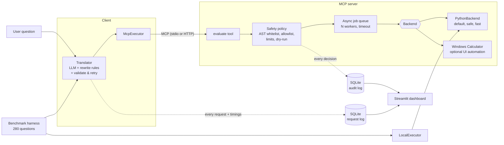
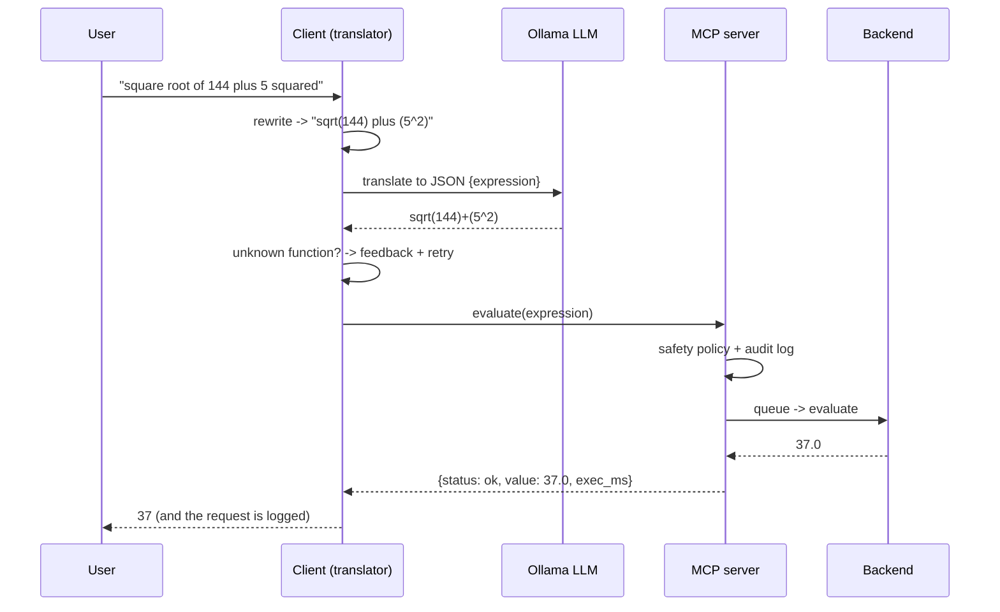

# mcpcalc - verified tool use for small local LLMs


A local LLM (Ollama) turns plain-English maths questions into expressions. An **MCP server** checks each expression
against a safety policy, runs it through a **swappable backend** (a safe Python evaluator, or the real Windows
Calculator app), and logs everything to SQL. A **benchmark harness** measures how reliable different models and
prompting strategies really are.

> "10 pencils cost 5 each, what do I get if I sell them all?" -> `10*5` -> **50**
> The model never does the arithmetic. It only translates; a tool executes; a separate evaluator verifies.

## Results at a glance

280 questions, 4 strategies, 2 local models, Python backend (1,120 runs per model). Full tables and analysis are in
[Benchmark results](#benchmark-results).

| model | baseline | prompt | rewrite | **full** |
|---|---|---|---|---|
| qwen2.5:7b | 92.5% | 98.2% | 98.2% | **99.3%** |
| llama3.1:8b | 87.5% | 92.5% | 92.5% | **92.9%** |

* The best configuration is **qwen2.5:7b with the full pipeline: 99.3% (278 of 280 correct)**.
* The biggest single improvement is the **prompt with a function list and worked examples** (+5.7 points for qwen,
  +5.0 for llama), mostly on the hard questions.
* **Validation with retry** recovered all invented-function cases for qwen but almost nothing for llama, because most
  of llama's remaining errors are *valid but wrong* expressions, which validation cannot detect.
* **Deterministic rewrites made no measurable difference** for either model.

## Why this project

Small local models (7-8B) are bad at arithmetic, so they are given tools, but they are also bad at *calling* tools:
they pick the wrong function (`power2` for "squared"), invent functions (`deg(60)`), or return broken output. This
project treats that as the research problem and answers it with measurements:

* **RQ1** How accurate are small local models at word problem -> expression translation?
* **RQ2** How much does each layer add: fuller prompt, deterministic rewrites, validation-with-retry? (ablation)
* **RQ3** What kinds of questions fail, and why? (error taxonomy)
* **RQ4** What does it cost in latency, and what does the safety policy block?

## Architecture





## Features

| Area | What it does |
|---|---|
| Translation strategies | `baseline` -> `prompt` -> `rewrite` -> `full` (rewrites + retry), selectable for the ablation study |
| Safety | AST whitelist (no `eval`), function allowlist, length/node/nesting/exponent limits, **dry-run mode**, audit log of every decision |
| Backends | `python` (default, safe evaluator) and `windows_calculator` (drives the real Calculator through UI Automation) |
| Server | MCP over **stdio** or **streamable HTTP**; bounded async queue with workers, timeouts and back-pressure |
| Logging | SQLite: every request with LLM / execution / total latency, retries, status and backend; separate audit table |
| Dashboard | Streamlit: success rate, p50/p95 latency, function usage, audit trail, benchmark results |
| Benchmark | 280 reproducible questions (easy/medium/hard/advanced), 95% confidence intervals, error taxonomy, plots |
| Quality | 258 tests, ruff, CI on Linux and Windows (Python 3.10 and 3.12) |

## Install

Requirements: Python 3.10+, [Ollama](https://ollama.com) running locally. The Windows backend also needs Windows 10/11.

```powershell
git clone https://github.com/TejasrinathreddySoma-beep/mcpcalc.git
cd mcpcalc
python -m venv .venv
.venv\Scripts\Activate.ps1                    # Linux/macOS: source .venv/bin/activate
pip install -e ".[dev,bench,dashboard]"       # everything except the Windows backend
pip install -e ".[windows]"                   # Windows only: adds pywinauto for the Calculator backend

ollama pull qwen2.5:7b
ollama pull llama3.1:8b
pytest -q                                     # optional: all tests, no Ollama and no Calculator needed
```

Open a **new terminal** for every long-running command below, and run `.venv\Scripts\Activate.ps1` in each one.

## Run it: choose a backend

The backend decides **who does the calculation**. Everything else (the LLM, safety policy, queue, logging) is identical.

| | `python` backend (default) | `windows_calculator` backend |
|---|---|---|
| What it does | evaluates the expression with a safe Python evaluator | types the expression into the real Windows Calculator and reads its display |
| Runs on | Windows, Linux, macOS | **Windows 10/11 only**, English display language |
| Speed | milliseconds | several seconds per calculation |
| Concurrency | `workers` in parallel (default 4) | one at a time (it uses your keyboard focus) |
| Use it for | daily use, HTTP server, benchmark, CI | live demos: watch the LLM operate a desktop app |
| Extra install | none | `pip install -e ".[windows]"` |

Both examples assume Ollama is running and the virtual environment is active.

### Option A - Python backend (default)

**1. Chat (one terminal).** The client starts its own server in the background:
```powershell
mcpcalc-chat
mcpcalc-chat --model llama3.1:8b              # use the other model for this session
```
The banner should say `backend: python`. Try `10 pencils cost 5 each, total?`, `sin 90`, `5 times log 5 base 4`.

**2. Server over HTTP with several clients (three terminals).**
```powershell
# terminal 1 - the server
mcpcalc-server --transport streamable-http --port 8765

# terminals 2 and 3 - any number of clients
mcpcalc-chat --url http://127.0.0.1:8765/mcp
```
Type the `mcpcalc-...` commands in the **terminal**, not in the chat: the chat only understands maths and conversation.

**3. Dashboard (another terminal).**
```powershell
streamlit run dashboard/app.py
```

**4. Benchmark.**
```powershell
mcpcalc-bench --models qwen2.5:7b llama3.1:8b          # 280 questions x 4 strategies per model (about 1.5 h each)
mcpcalc-bench --models qwen2.5:7b --limit 20 --strategies full        # 1-minute check
```

### Option B - Windows Calculator backend

**1. Check your setup once.**
```powershell
pip install -e ".[windows]"
python -c "from mcpcalc.backends.windows_backend import WindowsBackend; print(WindowsBackend().evaluate('sin(30)+cos(60)'))"
```
The Calculator window should open, switch to **Scientific** mode, type the expression and the terminal should print
`1.0`. If it prints an error instead, see [Troubleshooting](#troubleshooting). Do this before any demo.

**2. Chat (one terminal).**
```powershell
mcpcalc-chat --config config.windows.yaml
```
The banner should say `backend: windows_calculator`. Ask `5 times log 5 base 4` and watch the Calculator do it.
**While it types, do not touch the keyboard or mouse**, and do not minimise the Calculator.

**3. Windows backend through the HTTP server (two terminals).**
```powershell
# terminal 1
mcpcalc-server --backend windows_calculator --transport streamable-http --port 8765
# terminal 2
mcpcalc-chat --url http://127.0.0.1:8765/mcp
```
The chat banner shows the backend the **server** reports, so you can confirm which one is active. `/stats` shows it too.

**4. Benchmark through the real Calculator (slow - use a small sample).**
```powershell
mcpcalc-bench --backend windows_calculator --models qwen2.5:7b --strategies full --limit 20
```
Each question takes several seconds of UI automation, and the benchmark forces one question at a time. The results
file has a `backend` column, so Python and Calculator runs can be compared.

### Switching between backends (cheat sheet)

| I want to... | Command |
|---|---|
| chat with the Python backend | `mcpcalc-chat` |
| chat with the real Calculator | `mcpcalc-chat --config config.windows.yaml` |
| make Windows the default | set `backend: windows_calculator` in `config.yaml` |
| start an HTTP server with Python | `mcpcalc-server --transport streamable-http --port 8765` |
| start an HTTP server with the Calculator | `mcpcalc-server --backend windows_calculator --transport streamable-http --port 8765` |
| benchmark with Python (default) | `mcpcalc-bench --models qwen2.5:7b` |
| benchmark with the Calculator | `mcpcalc-bench --backend windows_calculator --limit 20` |
| list the Calculator's real button ids | `python -m mcpcalc.backends.windows_ui` |

## Chat commands

| Command | Effect |
|---|---|
| `/dry` | toggle dry-run: translate and validate, do not execute |
| `/angle deg\|rad\|grad` | angle unit for trig functions (default degrees) |
| `/strategy baseline\|prompt\|rewrite\|full` | change the translation strategy mid-session |
| `/stats` | success rate, p50/p95 latency, blocked count, queue depth and **active backend** |
| `/functions` | list supported functions |
| `exit` | quit |

## Safety model

Every expression passes the policy before anything runs, and every decision (allowed / blocked / dry_run) is written to
the audit table.

* parsed with `ast`, **never `eval`**; only numbers, `pi`, `e`, the operators `+ - * / ^ %` and plain function calls
  are allowed;
* a function **allowlist** (`safety.allowed_functions` in `config.yaml`);
* limits on expression length, node count, nesting depth and exponent size;
* **dry-run** mode (`mcpcalc-server --dry-run`, or `/dry` in the chat): validate and log, never execute;
* attribute access, strings, subscripts, lambdas, keyword arguments, `__import__(...)` and unknown names are rejected.

## Benchmark results

### Method

* **Dataset:** 280 questions, generated from templates with a fixed seed: 60 easy, 70 medium, 70 hard, 80 advanced
  (`benchmarks/questions.jsonl`). Each has a reference expression; the expected answer comes from an independent
  evaluator.
* **Setup:** temperature 0, one run per configuration, Python backend, Ollama on a single machine.
  Hardware: `Intel(R) Core(TM) Ultra 5 125H (3.60 GHz)/Intel(R) Arc(TM) Graphics (128 MB)/16.0 GB (15.4 GB usable) RAM`; `ollama version is 0.40.6`; run date: `19-10-2026`.
* **Correct** means the expression passed the safety policy and evaluated to the expected value (relative tolerance
  1e-6). Failures are classified: *wrong answer* (valid expression, wrong number), *blocked* (invented function or
  forbidden syntax), *not a calculation* (the model treated it as chat), *exec error* (maths error).
* **Strategies:** `baseline` = minimal prompt; `prompt` = function list and worked examples; `rewrite` = prompt plus
  fixed phrase rewrites ("5 squared" -> "(5^2)"); `full` = rewrite plus validation with feedback and up to 2 retries.

### Accuracy and error taxonomy

| model | strategy | n | accuracy | 95% CI | wrong answer | not a calc | blocked | exec error | retries / question |
|---|---|---|---|---|---|---|---|---|---|
| qwen2.5:7b | baseline | 280 | 92.5% | 88.8-95.0% | 3.2% | 2.1% | 1.4% | 0.7% | 0.00 |
| qwen2.5:7b | prompt | 280 | 98.2% | 95.9-99.2% | 0.0% | 0.7% | 1.1% | 0.0% | 0.00 |
| qwen2.5:7b | rewrite | 280 | 98.2% | 95.9-99.2% | 0.0% | 0.7% | 1.1% | 0.0% | 0.00 |
| qwen2.5:7b | **full** | 280 | **99.3%** | 97.4-99.8% | 0.0% | 0.7% | 0.0% | 0.0% | 0.01 |
| llama3.1:8b | baseline | 280 | 87.5% | 83.1-90.9% | 7.9% | 0.0% | 4.6% | 0.0% | 0.00 |
| llama3.1:8b | prompt | 280 | 92.5% | 88.8-95.0% | 5.4% | 0.0% | 2.1% | 0.0% | 0.00 |
| llama3.1:8b | rewrite | 280 | 92.5% | 88.8-95.0% | 5.4% | 0.0% | 2.1% | 0.0% | 0.00 |
| llama3.1:8b | **full** | 280 | **92.9%** | 89.2-95.3% | 5.4% | 0.0% | 1.8% | 0.0% | 0.00 |

### Accuracy by difficulty

| model | strategy | easy (60) | medium (70) | hard (70) | advanced (80) |
|---|---|---|---|---|---|
| qwen2.5:7b | baseline | 100.0% | 100.0% | 78.6% | 92.5% |
| qwen2.5:7b | prompt | 96.7% | 97.1% | 98.6% | 100.0% |
| qwen2.5:7b | rewrite | 96.7% | 97.1% | 98.6% | 100.0% |
| qwen2.5:7b | full | 96.7% | 100.0% | 100.0% | 100.0% |
| llama3.1:8b | baseline | 100.0% | 100.0% | 70.0% | 82.5% |
| llama3.1:8b | prompt | 100.0% | 94.3% | 84.3% | 92.5% |
| llama3.1:8b | rewrite | 100.0% | 94.3% | 84.3% | 92.5% |
| llama3.1:8b | full | 100.0% | 95.7% | 84.3% | 92.5% |

### What the results show

1. **The prompt is the biggest win.** Adding the function list and worked examples raised accuracy from 92.5% to 98.2%
   (qwen) and from 87.5% to 92.5% (llama). The gain comes from the hard questions (qwen 78.6% -> 98.6%, llama
   70.0% -> 84.3%) and the advanced ones (qwen 92.5% -> 100%, llama 82.5% -> 92.5%).
2. **qwen2.5:7b is the better model for this task.** For `prompt` and `full` the 95% intervals of the two models do not
   overlap (e.g. `full`: 97.4-99.8% vs 89.2-95.3%). For `baseline` they overlap, so that gap is not clearly
   significant.
3. **Validation with retry helps only with errors it can detect.** For qwen, `full` removed every *blocked* case
   (1.1% -> 0.0%): about 3 more questions correct. For llama it recovered about 1 question, because its remaining
   failures are mostly *wrong answers* (5.4%, about 15 questions): a valid expression that means the wrong thing passes
   validation. Catching those needs a second opinion on meaning, not a syntax check.
4. **Deterministic rewrites changed nothing.** `rewrite` is identical to `prompt` for both models. Once the prompt has
   worked examples, these models already handle "squared", "cube root" and "factorial".
5. **The two models fail differently.** llama writes wrong or invented expressions (wrong answer + blocked, never "not
   a calculation"). qwen almost never writes a wrong answer once prompted, but occasionally treats a question as chat
   (2 questions in every prompted strategy).
6. **Hard questions are the weak spot for llama** (84.3% even with `full`); qwen reaches 100% there.
7. **A longer prompt can also cost accuracy.** For qwen, easy questions went from 100% (baseline) to 96.7% (about 2
   questions) once the longer prompt was added.

### How far to trust the numbers

* One run per configuration at temperature 0. `prompt`, `rewrite` and `full` differ by 1-3 questions per model and
  their intervals overlap, so **differences among those three are not statistically significant**. Say "retry recovered
  the invented-function cases", not "full is better than prompt".
* **Latency is not comparable across strategies.** The strategies ran one after another, and per-question LLM time
  varied from about 3 to 6.5 s without a pattern (for llama, `full` does the most work yet measured 3.0 s against 6.5 s
  for `prompt`), which points to system noise. The Python execution step takes milliseconds.
* The questions are template-generated, so phrasing is narrower than real users'.
* `llama3.1:8b` took about 84 minutes for 1,120 runs.

### Reproduce

```powershell
python -m mcpcalc.questions                                  # regenerate the dataset (seed 42)
mcpcalc-bench --models qwen2.5:7b llama3.1:8b                # about 1.5 hours per model, nothing else using Ollama
mcpcalc-bench --llm oracle --limit 60                        # harness sanity check: must score exactly 100%
```
Output goes to `benchmarks/results/<timestamp>/` (`results.csv`, `summary.md`, `summary.json`,
`accuracy_by_strategy.png`). The runs behind the tables above are kept in `benchmarks/published/`.
See [benchmarks/README.md](benchmarks/README.md) for the scoring rules.

The `oracle` run (an "LLM" that returns the reference expression) proves that the dataset, evaluator and scoring code
agree with each other; it says nothing about any real model. It runs in CI.

## Configuration

Everything lives in [`config.yaml`](config.yaml) (all keys optional); [`config.windows.yaml`](config.windows.yaml) is
the same with the Calculator backend. Use `--config path.yaml` or the `MCPCALC_CONFIG` environment variable.

| Key | Meaning | Default |
|---|---|---|
| `llm.model` | Ollama model | `qwen2.5:7b` |
| `translator.strategy` | `baseline` / `prompt` / `rewrite` / `full` | `full` |
| `translator.max_retries` | retries when the LLM invents a function | `2` |
| `backend` | `python` or `windows_calculator` | `python` |
| `angle_mode` | `deg` / `rad` / `grad` | `deg` |
| `server.transport` | `stdio` or `streamable-http` | `stdio` |
| `server.host`, `server.port` | HTTP address | `127.0.0.1`, `8765` |
| `server.workers`, `queue_size`, `timeout_s` | queue behaviour (workers forced to 1 for the Calculator) | `4`, `100`, `30` |
| `safety.dry_run` | validate and log only | `false` |
| `safety.allowed_functions` | `all` or a list | `all` |
| `safety.max_expression_length`, `max_nodes` | size limits | `200`, `120` |
| `database.path` | SQLite file | `data/mcpcalc.db` |

## Tests and CI

```powershell
pytest --cov=mcpcalc          # 258 tests; no Ollama and no Windows Calculator needed
ruff check .
```
Coverage is 86% of the package. The UI-automation layer is excluded from the measure (it needs a real Windows desktop);
its key-sequence logic is tested against a fake Calculator instead. The chat loop and the Ollama adapter need a live
Ollama and are exercised manually. Integration tests start real server processes over stdio and HTTP (8 concurrent
clients). GitHub Actions runs everything on Ubuntu and Windows, Python 3.10 and 3.12.

## Project layout

```
src/mcpcalc/
  translator.py   prompts, rewrite rules, validate-and-retry, the four strategies
  safety.py       policy: AST whitelist, allowlist, limits, dry-run
  server.py       MCP tools + queue + logging (stdio / streamable-http)
  client.py       interactive chat client
  pipeline.py     translate -> execute -> log (shared by chat and benchmark)
  executors.py    LocalExecutor (in-process) and McpExecutor (over MCP)
  jobqueue.py     bounded async queue, workers, timeout
  db.py           SQLite request log + audit log
  llm.py          Ollama adapter, plus ScriptedLLM and OracleLLM used by tests and the benchmark sanity check
  benchmark.py    harness, statistics, plots      questions.py  dataset generator
  backends/       python_backend.py (default)  windows_backend.py + windows_ui.py (Calculator)
dashboard/app.py  Streamlit dashboard
benchmarks/       questions.jsonl, published/ (results behind the README tables)
docs/             REPORT_OUTLINE.md (final-year report structure + viva questions)
tests/            258 tests
config.yaml       config.windows.yaml
```

## Troubleshooting

| Problem | Fix |
|---|---|
| `mcpcalc-chat` is not recognised | the virtual environment is not active: `.venv\Scripts\Activate.ps1`, then retry |
| Typing `mcpcalc-server ...` in the chat gives "could not turn that into a supported expression" | that is a terminal command; run it in a separate terminal |
| First answer takes 20-30 s | Ollama is loading the model; the chat client now loads it at start-up and keeps it for 30 minutes |
| `Could not reach Ollama` | start it (`ollama serve`) and check `ollama list` shows the model |
| Windows backend: `No module named pywinauto` | `pip install -e ".[windows]"` |
| Windows backend: "dropdown / button not found" | Calculator button names depend on the Windows version and language. Switch Windows to English and run `python -m mcpcalc.backends.windows_ui` to list the real button ids |
| Windows backend: wrong or stale number | the result check catches it and retries; if it keeps failing, close all Calculator windows and retry without touching the keyboard |
| Windows backend: nothing happens in the benchmark | use a small `--limit`; each question takes seconds and the Calculator must stay unminimised |

## The Windows Calculator backend: honest notes

Button automation ids and names depend on the Windows version and display language, and UI automation is slow and
needs the desktop in the foreground. The design handles this instead of hiding it:

* every Calculator result is compared with an independent Python value and the entry is **retried**;
* if it still disagrees you get an **error, never a silently wrong number**;
* `python -m mcpcalc.backends.windows_ui` lists the real button ids on a machine so they can be corrected;
* the key-sequence compiler is tested without Windows against a fake Calculator (`tests/test_windows_keys.py`).

All benchmark numbers in this README come from the **Python backend**. The Calculator backend is the demonstration
and is verified at run time by the check above.

## Limitations and future work

* The benchmark is template-generated; add hand-written questions for a more realistic test.
* Trig uses degrees by default; `log` is base 10, `ln` natural.
* Results depend on the model and Ollama version; report them with those versions.
* Validation catches unknown functions and bad syntax, but not an expression that is valid and means the wrong thing.
  A semantic check (for example asking a second model, or comparing with a re-derivation) is the next step.
* **Future work:** generalise the UI backend to any application by reading its accessibility tree and generating tools
  automatically (e.g. Notepad; Excel is better driven through its own library), more models, a paired significance
  test, a user study.

## License

MIT - see [Teja](LICENSE).